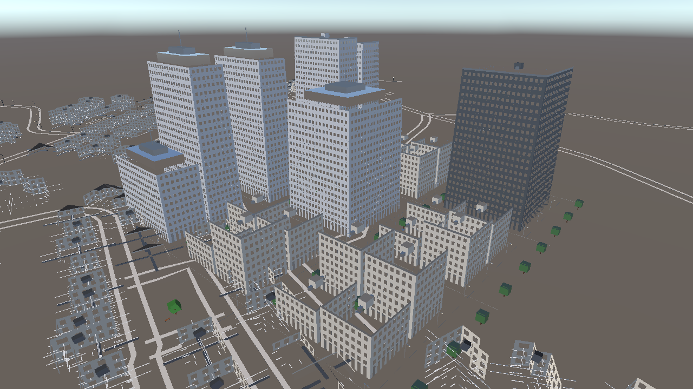
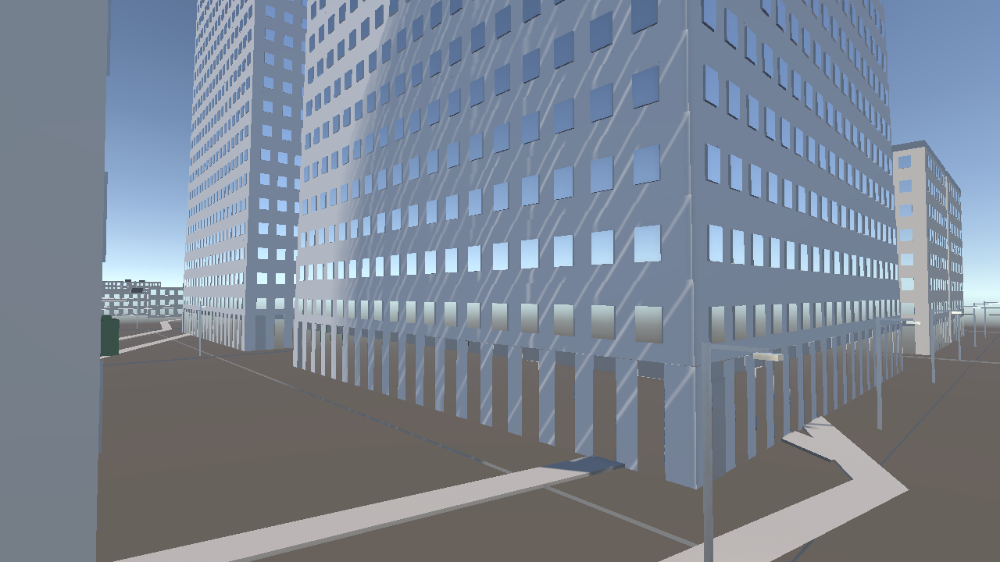
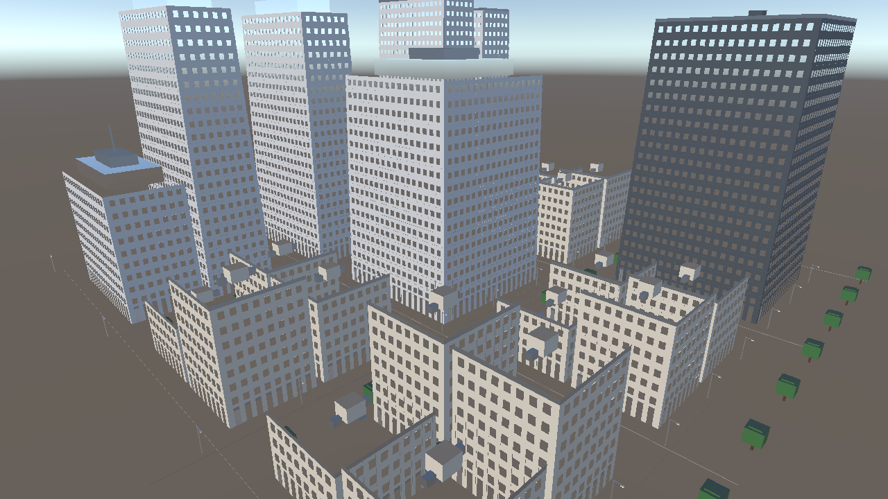
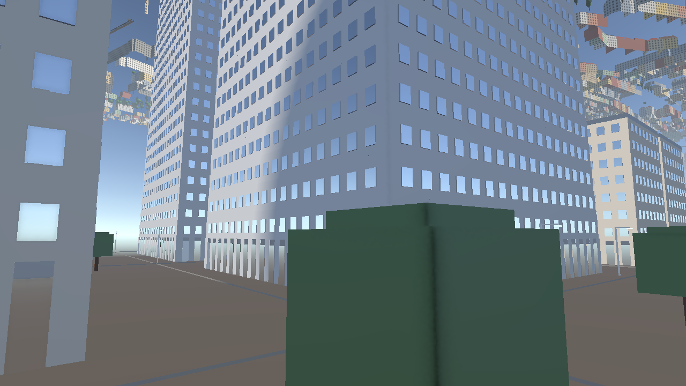

# 🏙️ City & Building Generator Toolkit for Unity (with OpenStreetMap)

[](https://unity.com/)
[](../../LICENSE)
[-brightgreen.svg)](#-faq--troubleshooting)
[](https://www.openstreetmap.org)
[](#-highlights--features)

A modular, zero-dependency procedural 3D town, building, and GIS city generator for Unity. Designed for game developers, urban designers, and indie creators who want to **generate 1:1 real-world towns from OpenStreetMap (OSM)** or create **custom procedural grid cities and standalone buildings** with a single click.

---

## 📸 Showcase

### 🌍 Real-World Town (OpenStreetMap GIS Extrusion)


*231 real-world building footprints, multi-storey towers, and 184 curving road segments extruded from OpenStreetMap GIS data in Unity.*


*Street perspective showing ground-floor commercial storefronts, recessed windows, concrete curbs, and pedestrian sidewalks.*

### 🏙️ Procedural Grid Cities


*Procedural grid city with zoned downtown skyscrapers, setbacks, pitched roofs, avenue trees, and streetlights.*


*Street-level view of a generated grid town.*

---

## ⚡ Highlights & Features

- **🗺️ Real-World OpenStreetMap Integration**
  - **Live Overpass API downloader:** Stream real-world GIS vector data inside the Unity Editor or in Play mode for any location worldwide.
  - **Offline / local file importer:** Open standard `.osm` (XML) or `.json` files exported from [OpenStreetMap.org](https://www.openstreetmap.org).
  - **Bundled offline sample:** Ships with a ~1 MB real-world dataset (Kaiserslautern, Germany) so you can test without an internet connection.
  - **1:1 geographic projection:** Equirectangular projection centered on your target coordinates (1 unit = 1 meter).
  - **Real building footprints:** Ear-clipping triangulation of arbitrary polygon footprints, multi-floor subdivisions, window bays, commercial shopfronts, and roofs (flat parapet, gabled, hipped).
  - **Real road networks:** Extruded 3D road ribbons along highway vectors with asphalt surface, raised concrete curbs (+0.15 m), and pedestrian sidewalks.
  - **Real parks & water:** Triangulated parks (`leisure=park`, `landuse=grass`), lakes, rivers, and streetlights.
- **🏢 Procedural Building Generator**
  - Footprint shapes: **Rectangle**, **L-Shape**, **U-Shape**, **T-Shape**, and **Custom Polygon**.
  - **Scene View vertex handles:** Drag vertices in the Scene View to sculpt custom footprints in real time.
  - Facade styles: Modern Glass, Classic Brick, European Plaster, Contemporary Panels, and Commercial Shopfront.
  - Architectural details: recessed windows, sills, lintels, balconies with metal railings, glass shopfronts, and entrance canopies.
  - Roof styles: Flat with Parapet (with AC chillers/bulkheads), Gabled, Hipped, Mansard, Rooftop Terrace, and Skyscraper Crown.
  - **One-click prefab export:** Save any generated building to your Assets folder as a reusable prefab.
- **🛣️ Procedural Grid Town Layout**
  - Customizable grid size (`blocksX × blocksZ`), block dimensions, road widths, and sidewalk widths.
  - Zoning system: Downtown Skyscrapers, Commercial Mid-Rise, Residential Apartments, Suburban Houses, and Public Park Plazas.
- **🎨 Render Pipeline Support & Zero Dependencies**
  - Works with the **Universal Render Pipeline (URP)** and the **Built-in Render Pipeline**.
  - **100% pure C#** using standard Unity Mesh and GameObject APIs. No external DLLs, Python scripts, or third-party packages.

---

## 📥 Installation

### Method 1: Open the Standalone Project in Unity Hub (Recommended)

1. Clone this repository:

   ```bash
   git clone https://github.com/asadal12/CityBuilderToolkit.git
   ```

2. Open **Unity Hub** and click **Add → Add project from disk**.
3. Select the `CityBuilderToolkit` folder.
4. Open the project with **Unity 6** (the project was saved with `6000.6.7f1`).
5. Load the demo scene: `Assets/CityBuilderToolkit/Scenes/TownGeneratorDemo.unity`.
6. Press **Play** and fly through the town with **WASD + mouse look**.

### Method 2: Import into an Existing Unity Project (Unity 2022.3 LTS+)

1. Copy the `Assets/CityBuilderToolkit/` folder from this repository into your project's `Assets/` directory.
2. Unity compiles the scripts automatically.
3. Open the tools from the top menu: **Tools → City & Building Generator**.

---

## 🚀 Step-by-Step Instructions

### 1. Generating a Real Town from OpenStreetMap (OSM)

1. In the Unity top menu, open **Tools → City & Building Generator** (or **Window → City & Building Generator**).
2. Select the **🗺️ Real Town (OSM)** tab.
3. **Choose a location** — pick a preset:

   | Preset | Latitude | Longitude |
   |---|---|---|
   | 🇩🇪 Kaiserslautern City Center | 49.4447 | 7.7690 |
   | 🎓 Kaiserslautern RPTU Campus | 49.4245 | 7.7535 |
   | 🇩🇪 Berlin Alexanderplatz & Mitte | 52.5219 | 13.4132 |
   | 🇫🇷 Paris Eiffel Tower & Seine | 48.8584 | 2.2945 |
   | 🇬🇧 London Westminster & Big Ben | 51.5007 | -0.1246 |
   | 🇺🇸 New York Times Square | 40.7580 | -73.9855 |
   | 🇯🇵 Tokyo Shibuya Crossing | 35.6595 | 139.7005 |

   Or choose **🌐 Custom Coordinates** and enter your own latitude, longitude, and radius (150–2000 m).
4. **Configure layers:** toggle Buildings, Roads & Sidewalks, Parks & Waterways, and Streetlights & Benches.
5. **Generate:**
   - Click **🌍 Download & Generate Real Town (Overpass API)** to stream live data.
   - Or click **📂 Load Bundled Offline Sample (Kaiserslautern)** to generate instantly offline.
   - Or click **📁 Select Local .osm / .json File...** to import an OSM file you exported from [openstreetmap.org](https://www.openstreetmap.org).

You can also add a generator directly from the Hierarchy: **GameObject → 3D Object → City Builder → Real Town (OpenStreetMap)**.

### 2. Generating a Procedural Grid City

1. Open **Tools → City & Building Generator** and switch to the **🏙️ Grid Town** tab.
2. Adjust the grid:
   - **Blocks (X-Axis)** and **Blocks (Z-Axis)** (1–10 each, e.g. 3×3 or 5×5)
   - **Block Size X / Z** (30–100 m)
   - **Road Width** and **Sidewalk Width**
3. Toggle street props: Avenue Trees, Street Lights, Park Benches.
4. Click **🚀 Generate Procedural Grid Town**.
5. Use **🎲 Randomize Seed & Regenerate** to explore endless variations.

### 3. Spawning & Customizing Single Buildings

1. Right-click in the Hierarchy and select **3D Object → City Builder → Procedural Building**
   (or use the **🏢 Single Building** tab → **🏗️ Spawn Building at Scene Center**).
2. In the Inspector, adjust:
   - **Footprint Shape:** Rectangle, L-Shape, U-Shape, T-Shape, or Custom Polygon.
   - **Dimensions:** width, depth, floor count, floor height, and setback per floor.
   - **Facade Style:** Modern Glass, Classic Brick, European Plaster, Contemporary Panels, Commercial Shopfront.
   - **Roof Style:** Flat with Parapet, Gabled, Hipped, Mansard, Rooftop Terrace, Skyscraper Crown.
   - **Details:** balconies, ground-floor commercial storefronts, and canopies.
3. **Sculpting with vertex handles:**
   - Set the shape to `CustomPolygon`.
   - In the Scene View, drag the yellow vertex handles to reshape the footprint in real time.
4. Click **💾 Save Mesh to Assets as Prefab** to save the building as an independent asset.

---

## 💻 Scripting API Examples

You can generate real towns and buildings from your own C# scripts.

### Generate a Real Town from Code

```csharp
using UnityEngine;
using CityBuilderToolkit.OSM;

public class CitySpawner : MonoBehaviour
{
    void Start()
    {
        var go = new GameObject("MyRealCity");
        var gen = go.AddComponent<RealTownGenerator>();

        // Set coordinates (e.g. Paris, Eiffel Tower)
        gen.latitude = 48.8584;
        gen.longitude = 2.2945;
        gen.radiusMeters = 600f;

        // Configure layers
        gen.generateBuildings = true;
        gen.generateRoads = true;
        gen.generateParksAndWater = true;
        gen.spawnStreetFurniture = true;

        // Download from the Overpass API and generate
        gen.GenerateFromOverpass(() =>
        {
            Debug.Log("Real city successfully built in Unity!");
        });
    }
}
```

### Generate a Procedural Building from Code

```csharp
using UnityEngine;
using CityBuilderToolkit.Buildings;
using CityBuilderToolkit.Core;

public class BuildingSpawner : MonoBehaviour
{
    void Start()
    {
        var go = new GameObject("CustomSkyscraper");
        var bg = go.AddComponent<BuildingGenerator>();

        bg.shape = FootprintShape.Rectangle;
        bg.width = 24f;
        bg.depth = 18f;
        bg.floors = 16;
        bg.setbackPerFloor = 0.04f;

        bg.style.facadeStyle = FacadeStyle.ModernGlass;
        bg.style.roofStyle = RoofStyle.SkyscraperCrown;
        bg.style.hasGroundFloorCommercial = true;

        bg.Generate();
    }
}
```

---

## 📁 Repository Structure

```text
CityBuilderToolkit/
├── Documentation/
│   └── Images/                       # Screenshots used in this README
├── Assets/
│   └── CityBuilderToolkit/
│       ├── Runtime/
│       │   ├── OSM/                  # OpenStreetMap GIS engine
│       │   │   ├── OsmDataModel.cs           # Nodes, ways, relations, GPS → Unity meters projection
│       │   │   ├── OsmParser.cs              # XML (.osm) and JSON OpenStreetMap parser
│       │   │   ├── OsmOverpassClient.cs      # Live Overpass API client with mirror failover
│       │   │   ├── OsmBuildingBuilder.cs     # Real 3D building mesh compiler
│       │   │   ├── OsmRoadBuilder.cs         # Road ribbons, curbs, sidewalks, and markings
│       │   │   ├── OsmEnvironmentBuilder.cs  # Parks, water bodies, and street furniture
│       │   │   └── RealTownGenerator.cs      # Main MonoBehaviour for real cities
│       │   ├── Core/                 # Procedural mesh & math engine
│       │   │   ├── MeshBuilder.cs            # 6-submesh geometry engine
│       │   │   ├── Polygon2D.cs              # Ear-clipping triangulation & polygon offsets
│       │   │   └── BuildingData.cs           # Architectural enums & configs
│       │   ├── Buildings/            # Building generators
│       │   │   ├── BuildingGenerator.cs      # Single building component
│       │   │   ├── FacadeGenerator.cs        # Windows, sills, balconies, and canopies
│       │   │   └── BuildingPreset.cs         # ScriptableObject preset container
│       │   ├── Roads/                # Road networks
│       │   │   ├── RoadNetworkGenerator.cs   # Grid road network
│       │   │   └── StreetFurnitureSpawner.cs # Trees, streetlights, and benches
│       │   ├── Town/                 # Grid town & zoning
│       │   │   ├── TownGenerator.cs          # Grid town controller
│       │   │   ├── TownBlock.cs              # Parcel subdivision & courtyards
│       │   │   └── TownZoning.cs             # Zoning rules
│       │   ├── Materials/            # Pipeline-agnostic materials
│       │   │   └── CityMaterialPalette.cs    # URP / Built-in shader detection & palettes
│       │   └── Demo/                 # Player controls
│       │       └── FreeFlyCamera.cs          # WASD + mouse look inspection camera
│       ├── Samples/
│       │   └── Kaiserslautern_Sample.osm     # Bundled ~1 MB offline OSM sample
│       ├── Scenes/
│       │   └── TownGeneratorDemo.unity       # Pre-configured demo scene
│       └── Editor/                   # Editor windows & custom inspectors
│           ├── TownGeneratorWindow.cs        # 4-tab window (Tools → City & Building Generator)
│           ├── RealTownGeneratorEditor.cs    # Custom Inspector for RealTownGenerator
│           ├── BuildingGeneratorEditor.cs    # Scene View polygon handles & Inspector
│           ├── TownBuilderMenu.cs            # Hierarchy menu shortcuts
│           ├── RealTownDemoRunner.cs         # Headless test & screenshot runner
│           └── CityBuilderDemoRunner.cs      # Demo scene creator
├── Packages/
│   └── manifest.json                 # Unity package manifest
├── ProjectSettings/
│   └── ProjectVersion.txt            # Unity Editor version
├── .gitignore                        # Unity ignore rules
├── .gitattributes                    # Line ending handling
├── LICENSE                           # MIT license
└── README.md                         # This file
```

---

## ❓ FAQ & Troubleshooting

**Q: Which Unity versions are supported?**
A: The toolkit scripts target **Unity 2022.3 LTS** through **Unity 6 (6000.x)**. The standalone project itself was saved with Unity `6000.6.7f1`; on 2022.3, use Method 2 and copy the `Assets/CityBuilderToolkit/` folder into your own project.

**Q: Do I need to install any external packages or Python?**
A: **No.** The toolkit is 100% C# using standard Unity APIs. No Python, external DLLs, or NuGet packages are required.

**Q: How do I export an OSM file for my hometown?**

1. Visit [OpenStreetMap.org](https://www.openstreetmap.org).
2. Pan and zoom to the neighborhood you want.
3. Click **Export** in the top bar.
4. Click the blue **Export** button in the left sidebar to download the `.osm` file.
5. In Unity, open **Tools → City & Building Generator**, choose **📁 Select Local .osm / .json File...**, and pick the downloaded file.

**Q: The Overpass download fails or times out.**
A: Public Overpass servers are rate-limited. Try a smaller radius, wait a moment and retry, or export an `.osm` file from openstreetmap.org and load it locally.

**Q: Can I use this in commercial games?**
A: Yes. The code is MIT licensed. When you use real-world OpenStreetMap data, include the attribution: © OpenStreetMap contributors (ODbL).

---

## 📄 License

This project is licensed under the MIT License — see the [LICENSE](../../LICENSE) file for details.
Map data © [OpenStreetMap contributors](https://www.openstreetmap.org/copyright), available under the Open Database License (ODbL).
